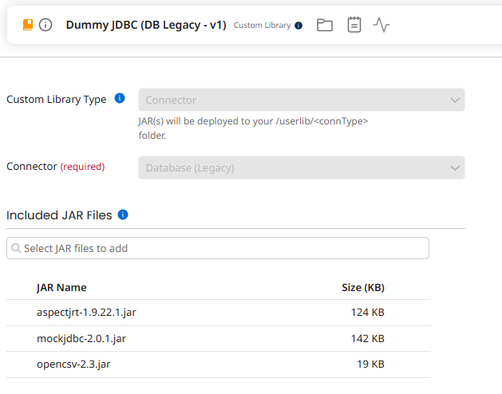
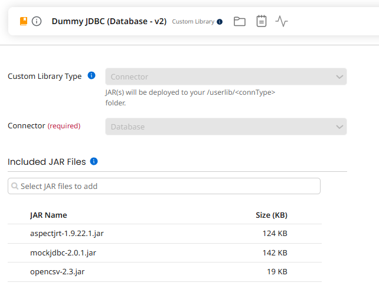

# mockjdbc – Features

mockjdbc (formerly dummyjdbc) is a JDBC driver that never talks to a real database. Your code opens a normal
`java.sql.Connection`, runs normal SQL, and gets back the result sets *you* have prepared –
either **in memory** (a CSV string inside your test) or **on file** (CSV files on disk / classpath).

This guide starts from the simplest case and builds up.

**Contents**

1. [Setup](#1-setup)
2. [Quick start: in-memory dataset](#2-quick-start-in-memory-dataset)
3. [How a query finds its dataset](#3-how-a-query-finds-its-dataset)
4. [Different results for different parameters](#4-different-results-for-different-parameters)
5. [Step-based results (a scripted sequence)](#5-step-based-results-a-scripted-sequence)
6. [Capturing statement parameters](#6-capturing-statement-parameters)
7. [Datasets on file](#7-datasets-on-file)
8. [Several "databases" with JDBC URLs](#8-several-databases-with-jdbc-urls)
9. [CSV format reference](#9-csv-format-reference)
10. [Resolution order and good-to-know](#10-resolution-order-and-good-to-know)
11. [Running inside Boomi](#11-running-inside-boomi) (with an [example](#example-unit-test-of-a-boomi-process))
12. [API summary](#12-api-summary)

---

## 1. Setup

Put the jar and its runtime dependencies on the classpath (see [Installation](README.md#installation)) and make sure
the driver class is loaded; it registers itself with `DriverManager` on load:

```java
Class.forName(MockJdbcDriver.class.getCanonicalName());
Connection connection = DriverManager.getConnection("any");
```

The driver accepts the URL `any` (handy in tests) and URLs starting with `jdbc::mock::`
(see [section 8](#8-several-databases-with-jdbc-urls)).

---

## 2. Quick start: in-memory dataset

Register a CSV string under a name, then run a query that resolves to that name.
The first line is the header, the following lines are rows.

```java
Class.forName(MockJdbcDriver.class.getCanonicalName());
MockJdbcDriver.reset();                       // start from a clean state

MockJdbcDriver.addInMemoryTableResource("users",
        "name, age\n" +
        "John, 20\n" +
        "Mary, 31");

Connection connection = DriverManager.getConnection("any");
PreparedStatement statement = connection.prepareStatement("SELECT * FROM users");
ResultSet rs = statement.executeQuery();

while (rs.next()) {
    String name = rs.getString("name");        // by label (case-insensitive)
    int age     = rs.getInt(2);                // or by 1-based index
}
```

Your application code does not know the difference: it is plain JDBC.
The name (`users`) is the **table name found in the SQL** (`FROM users`), matched case-insensitively.

Instead of a `String` you can also pass an `InputStream`, e.g. a file from `src/test/resources`:

```java
MockJdbcDriver.addInMemoryTableResource("users",
        getClass().getResourceAsStream("/users.csv"));
```

---

## 3. How a query finds its dataset

For every query the driver builds a *resource name* and looks for a dataset registered under it.
Three ways to select it:

### a) Table name deduction (default)

The name is taken from the word after `FROM`:

```sql
SELECT name FROM mytable WHERE surname = 'Happy'   -- resource: mytable
```

### b) Explicit `-- QUERY_ID:` comment (recommended)

Give the query a name with a comment on the first line:

```sql
-- QUERY_ID: ecommerce.create-order-ws.select-customer
SELECT * FROM customers WHERE id = ?        -- resource: ecommerce.create-order-ws.select-customer
```

```java
MockJdbcDriver.addInMemoryTableResource("ecommerce.create-order-ws.select-customer", "id, name\nC42, ACME");
```

* The comment wins over the table name, for reads ([section 4](#4-different-results-for-different-parameters)) and
  for writes ([section 6](#6-capturing-statement-parameters)).
* The ID is one word: the rest of the first line, trimmed. Spaces, `?`, `#` and `,` (the separators of the lookup
  names) are not allowed, and an invalid or empty ID makes the statement fail with an `SQLException`.
* `QUERY_ID` must be on the **first line**, right after `--` (the keyword is case insensitive). The query can continue
  on as many lines as needed, with `\n` or `\r\n` line endings.
* The comment is plain SQL, so the same statement runs unchanged on the real database.

See [Best practice: an ID for every query](#best-practice-an-id-for-every-query).

The older form `-- TESTCASE: name` still works the same way, without the checks on the name (an empty name is ignored).

### Best practice: an ID for every query

Name every statement of your process with a `-- QUERY_ID:`. The ID becomes the contract between the code and its
tests: datasets, captured parameters and counters ([section 5](#repeated-use-of-the-same-resource-users1-users2)) are
per query, not per table, and a test does not change when the SQL changes.

* Group the IDs by project and by service (flow, interface), then give each step a meaningful name:
  `<project>.<service>.<step>`, e.g. `ecommerce.create-order-ws.select-customer`,
  `ecommerce.create-order-ws.insert-order`.
* Use lower case letters, digits, `.`, `-` and `_`. Lower case IDs are also the simplest to use inside Boomi
  ([section 11](#property-names)).
* Keep the IDs unique: two statements with the same ID share the dataset and the counter.
* A test written against table names breaks when you add an ID to its queries (the resource name changes): update
  both together.
* Statements generated by a tool, with no SQL text of yours to put the comment in, are still recognised by table
  name.

### c) Stored procedures

`EXEC my_proc ...`, `EXECUTE my_proc ...`, `CALL my_proc(...)` and the JDBC escape `{call my_proc(...)}` (also
`{? = call my_proc(...)}`) resolve to the resource `my_proc`, so stored-procedure results can be mocked the same way
as tables. The call can span several lines.

### Fallbacks

* `SELECT 1`-style queries without a `FROM` return a single row with the value `1`.
* If nothing is found, the driver returns an empty result set instead of failing.

Names are case-insensitive for in-memory resources.

---

## 4. Different results for different parameters

With a `PreparedStatement` the driver also tries a more specific name that includes the bound parameters:
`<resource>?<param1>,<param2>,...`. If it exists it is used, otherwise it falls back to `<resource>`.

```java
MockJdbcDriver.addInMemoryTableResource("mytable?Smith,34", "name\nJohn Smith");
MockJdbcDriver.addInMemoryTableResource("mytable",          "name\n(anybody else)");

PreparedStatement ps = connection.prepareStatement(
        "SELECT name FROM mytable WHERE surname = ? AND age = ?");
ps.setString(1, "Smith");
ps.setInt(2, 34);
ResultSet rs = ps.executeQuery();              // -> "John Smith"
```

Lookup order for the query above (always case-insensitive):

1. `mytable?Smith,34`
2. `mytable`

Parameters are rendered with `toString()`. `Date`, `Time` and `Timestamp` use the formats described in
[section 9](#dates-and-times).

---

## 5. Step-based results (a scripted sequence)

Sometimes you don't care what the SQL says – you only know *"the first query returns A, the second returns B"*.
Register results by the **execution step** instead of by name:

```java
MockJdbcDriver.reset();                       // resets the step counter to the beginning
MockJdbcDriver.addInMemoryTableResource(0, "name, age\nJohn, 20");
MockJdbcDriver.addInMemoryTableResource(1, "id, country\n1, Italy\n2, USA");
MockJdbcDriver.addInMemoryTableResource(2, "id, make, model\n1, Mazda, CX-5");

Connection c = DriverManager.getConnection("any");

ResultSet first  = c.prepareStatement("whatever").executeQuery();   // step 0 -> John
ResultSet second = c.prepareStatement("whatever").executeQuery();   // step 1 -> countries
ResultSet third  = c.createStatement().executeQuery("anything");    // step 2 -> cars
```

* The step counter increases **each time a statement is created** (`createStatement` / `prepareStatement`),
  starting from 0 after `reset()`.
* A step resource has the **highest priority**: table name and `-- QUERY_ID:` comments are ignored for that statement.
* Call `MockJdbcDriver.reset()` at the start of every test, otherwise the counter carries over.
* For `executeUpdate`, a step resource whose content is a plain number is returned as the *affected rows count*
  (e.g. `addInMemoryTableResource(3, "5")`).

### Repeated use of the same resource (`users#1`, `users#2`)

When the **same query** must return different data each time it runs, number the resource with `#n`: `users#1` is used
the first time `users` is queried, `users#2` the second time, and so on. When the numbered resource does not exist the
driver falls back to `users`, so you only define the occurrences that differ:

```java
MockJdbcDriver.reset();
MockJdbcDriver.addInMemoryTableResource("users#1", "name\nJohn");           // first SELECT * FROM users
MockJdbcDriver.addInMemoryTableResource("users#2", "name\nJohn\nMary");     // second one
MockJdbcDriver.addInMemoryTableResource("users",   "name");                  // third and later: no rows
```

* There is **one counter per resource name** (table, `-- QUERY_ID:` name or stored procedure), case insensitive
  (`FROM Users` and `FROM users` count together), shared by queries and writes: a SELECT on `users` followed by an
  INSERT into `users` is occurrence 1 and then 2 (see [section 6](#6-capturing-statement-parameters)).
* With parameters the lookup is `users?Smith,34#2` → `users?Smith,34` → `users#2` → `users`: the counter does not depend
  on the parameters.
* A `PreparedStatement.execute()` that both returns a result and captures parameters (e.g. `EXEC my_proc ?`) counts as
  one use: it reads `my_proc#n` and writes `my_proc_PARAMS#n` with the same `n`.
* Steps are not numbered (they already are a sequence), and `DatabaseMetaData.getColumns` does not count.
* The counters (and the step counter) belong to the **current thread**. They restart with `MockJdbcDriver.reset()`
  (which also clears the resources) or `MockJdbcDriver.resetCounters()` (counters only). Inside Boomi they also restart
  automatically, see [section 11](#11-running-inside-boomi).

---

## 6. Capturing statement parameters

To verify that your application wrote the right data or called the right procedure, the driver records the parameters
of every prepared statement **except SELECTs** as a comma-separated string, under the name `<name>_PARAMS`:

| Statement | Captured as |
|-----------|-------------|
| `INSERT INTO users (...) VALUES (?, ?)` | `users_PARAMS` |
| `UPDATE users SET ...` | `users_PARAMS` |
| `DELETE FROM users WHERE ...` | `users_PARAMS` |
| `EXEC my_proc ?, ?`, `EXECUTE my_proc ...`, `CALL my_proc(?)`, `{call my_proc(?)}` | `my_proc_PARAMS` |
| any statement but a SELECT with a `-- QUERY_ID: name` (or `-- TESTCASE: name`) comment | `name_PARAMS` |
| any statement but a SELECT run on a step resource ([section 5](#5-step-based-results-a-scripted-sequence)) | `##STEP<n>_PARAMS` |

The parameters of a `SELECT` (also after `--` comment lines, with a QUERY_ID comment or on a step) are **never**
captured: they only choose the data to return (see [section 4](#4-different-results-for-different-parameters)).

```java
PreparedStatement ps = connection.prepareStatement(
        "INSERT INTO users (name, age) VALUES (?, ?)");
ps.setString(1, "hello");
ps.setInt(2, 30);
ps.execute();

String params = MockJdbcDriver.getInMemoryTableResource("users_PARAMS");
Assert.assertEquals("hello,30", params);
```

* `executeUpdate` reports **1 affected row** when the table is recognised, `0` otherwise.
* The statement can span several lines (`\n` or `\r\n`) and can start with a `--` comment line.
* With an explicit `-- QUERY_ID: name` (or `-- TESTCASE: name`) comment the key is `name_PARAMS`.
* The table name in `INSERT INTO <table> (` / `UPDATE <table>` / `DELETE FROM <table>` is matched with letters only (`[a-zA-Z]`),
  so names with digits or underscores are not captured by name – use a `-- QUERY_ID:` comment for those.
* `<name>_PARAMS` always holds the **latest** parameters (the common single-write test). Every write is also kept as
  `<name>_PARAMS#n`, numbered with the counter of the name
  ([repeated use](#repeated-use-of-the-same-resource-users1-users2)): two INSERTs into `users` give
  `users_PARAMS#1`, `users_PARAMS#2`, and `users_PARAMS` equal to the second one. Statements on a step resource are not
  numbered.
* Batches (`addBatch()` + `executeBatch()`) run the statement once per parameter set, each run captured as above (so
  the last set is the one you read); `executeBatch()` returns `1` per recognised statement, `0` otherwise.
* A parameter that was not set is left empty (`{? = call my_proc(?)}` with only the second one set gives `,a`).

---

## 7. Datasets on file

For larger or shared data, keep the CSV in a file. There are three ways to wire files in.

### a) Register a file for a table

```java
MockJdbcDriver.addTableResource("test_table",
        new File(getClass().getResource("/test_table.csv").toURI()));

Connection c = DriverManager.getConnection("any");
ResultSet rs = c.prepareStatement("SELECT * FROM test_table").executeQuery();
```

`src/test/resources/test_table.csv`:

```csv
ID, country_name, country_iso
1, Germany, DE
2, Spain, ES
3, France, FR
```

Table names are matched case-insensitively, and you can register as many tables as you need by calling
`addTableResource` repeatedly. Tables can also be registered after the connection has been opened, and
`MockJdbcDriver.reset()` does not detach connections that are already open.

### b) The `/tables/` classpath folder (zero setup)

If nothing else matches, the driver looks for `/tables/<tablename>.csv` on the classpath
(e.g. `src/test/resources/tables/users.csv` for `SELECT * FROM users`). No Java code needed.

The `tables/` folder can be in a directory of the classpath or **inside a jar** (e.g. a jar of test data next to the
driver, the only option in runtimes such as Boomi). The file is looked up with the driver's class loader, the table
name in lower case, and read with the default charset of the VM; a jar is read without caching, so it is not kept open.

### c) A directory per "database"

See the next section.

If both a file and an in-memory resource exist for the same name, the **file wins**.
Step resources ([section 5](#5-step-based-results-a-scripted-sequence)) always win over both.

---

## 8. Several "databases" with JDBC URLs

Use a URL of the form `jdbc::mock::<dir>[::<subdir>...]` to point to a **classpath directory**.
Every `*.csv` file in it becomes a table (file name without extension = table name):

```
src/test/resources/
└── database/
    └── test_table.csv
```

```java
Connection c = DriverManager.getConnection("jdbc::mock::database");
ResultSet rs = c.prepareStatement("SELECT * FROM test_table").executeQuery();
```

* `jdbc::mock::a::b` maps to the directory `a/b`.
* Different URLs give you different, independent sets of tables (e.g. one per simulated database).
* A missing directory raises a `RuntimeException`.

---

## 9. CSV format reference

```csv
string_column, int_column|integer, boolean_column, bigdecimal_column, date_column
string_value,  17,                 true,           123456789123456789, 17-MAY-12
```

### File structure

* **Header first**, then one line per row.
* **Separator is the comma** (`,`), always. A `;`-separated file is read as a single column.
* Text with commas, line breaks or quotes goes between double quotes (`"Smith, John"`); a quote inside is doubled
  (`"say ""hi"""`).
  Write an empty quoted value without a space after the comma (`a,""`): with a space (`a, ""`) it is read as a
  single `"`.
* **Whitespace around values is always removed**, also inside quotes: `"  x  "` is read as `x`.
* Every row must have as many values as the header, otherwise an `IllegalArgumentException` is thrown.
* A header-only CSV gives an empty result set (no rows).
* Column names are case-insensitive when reading values (`getString("name")` = `getString("NAME")`), while
  `ResultSetMetaData.getColumnName()` / `getColumnLabel()` return them **as written** in the header (without `|type`),
  like a real database. Duplicate columns are rejected.
* Encoding: see [section 10](#10-resolution-order-and-good-to-know).

### Column names and types

The header can optionally declare a type with `name|type`: `varchar` (default), `integer`, `bigint`, `double`,
`decimal`, `boolean`, `date`, `time`, `timestamp`. The type is only exposed through `ResultSetMetaData`
(`getColumnType`, `getColumnTypeName`, `getColumnClassName`, ...) and `DatabaseMetaData.getColumns`; it does **not**
change how values are parsed. A typed column can be read by its plain name
(`rs.getInt("id")` for a header `id|integer`); the full header text (`"id|integer"`) works too.

### Values per data type

Every value is stored as text. What is accepted is decided by the getter your code calls, not by the header:

| Getter | Accepted text | Notes / what happens otherwise |
|--------|---------------|--------------------------------|
| `getString` | anything | Returned trimmed. An empty value is `""`. |
| `getInt` | optional sign and digits: `17`, `-17`, `+17` | `17.0`, `1,000`, `0x10`, empty text or values above `2147483647` throw `NumberFormatException`. |
| `getBigDecimal` | decimal number: `123456789123456789`, `12.50`, `-0.5`, `.5`, `1.5E+3` | Empty text gives `0` (`null` in a typed column, see NULL values below). Text such as `abc` or `NULL` throws `NumberFormatException`. Use `.` as decimal point and no thousands separator (a comma would need quotes and is not accepted). |
| `getLong`, `getShort`, `getByte` | optional sign and digits, within the range of the type | Empty text gives `0`. Decimals, separators or out-of-range values throw `NumberFormatException`. |
| `getDouble`, `getFloat` | decimal number with `.` as decimal point: `12.5`, `-0.25`, `1.5E+3` | Empty text gives `0`. Invalid text throws `NumberFormatException`. |
| `getBoolean` | `true` in any case (`true`, `TRUE`, `True`) | **Everything else is `false`**, including `1`, `yes`, `y` and empty text. |
| `getDate` / `getTime` / `getTimestamp` | see [Dates and times](#dates-and-times) | |

Getters by column label or by 1-based index behave the same.

**NULL values.** An **empty value in a column whose declared type is not `varchar`** (for example `id|integer`,
`price|double`, `day|date`) is SQL `NULL`: `getObject`, `getString`, `getBigDecimal` and the date getters return
`null`, the primitive getters return `0` / `false`, and `wasNull()` returns `true`. In `varchar` columns, and in columns
without a declared type, an empty value is the empty string `""` (and `wasNull()` is `false`), so `NULL` cannot be
represented there. The text `NULL` is always just the string `"NULL"`. A quoted empty value (`""`) is the same as an
empty one: the CSV reader does not tell them apart.

**`getObject`** returns the value converted to the Java type of the declared column type: `Integer` (`integer`),
`Long` (`bigint`), `Double` (`double`), `BigDecimal` (`decimal`), `Boolean` (`boolean`), `java.sql.Date` / `Time` /
`Timestamp` (`date` / `time` / `timestamp`, parsed with the formats below) and `String` for `varchar` or no type.
`getObject(column, Class)` accepts that class or `String.class`.

**Other methods.** `getRow()` returns the number of the current row (1 for the first, 0 before the first and after the
last); `findColumn(name)` returns the 1-based index of a column (case insensitive). `getBytes` returns `null`.

### Dates and times

There is no separate `datetime` type: use **`timestamp`** for date + time. The value is stored as plain text in the CSV and
converted when your code calls `getDate`, `getTime` or `getTimestamp`, using these default formats
(`SimpleDateFormat` patterns):

| JDBC getter    | Default pattern       | Example in the CSV     |
|----------------|-----------------------|------------------------|
| `getDate`      | `dd-MMM-yy`           | `17-MAY-12`            |
| `getTime`      | `HH:mm`               | `14:30`                |
| `getTimestamp` | `yyyyMMdd HHmmss.SSS` | `20120517 143000.000`  |

What this means in practice:

* **Each getter has its own format.** A date-only value cannot be read with `getTimestamp` (and vice versa) unless you
  change the formats. The `|date` / `|time` / `|timestamp` type in the header only affects `ResultSetMetaData`,
  not parsing.
* **Date month names depend on the JVM default locale.** `17-MAY-12` works with English, but with an Italian locale you need
  `17-MAG-12`. Case does not matter, and a 4-digit year (`17-May-2012`) is accepted. Set a numeric pattern (below)
  to be locale-independent.
* **Time seconds are dropped by the default format:** `14:30:15` is read as `14:30:00`. Use `HH:mm:ss` if you need them.
* **The timestamp default needs the milliseconds:** `20120517 143000` fails, `20120517 143000.000` works.
* Parsing only checks the beginning of the text, so trailing characters are ignored (`17-MAY-12 10:30` is read as the date
  `17-MAY-12`). A value that does not match throws an `SQLException` ("Could not parse date ...").
* Values are interpreted in the JVM default time zone.
* `getObject(...)` is not implemented for CSV result sets (it returns `null`): use the typed getters.

**Using ISO-like formats instead.** Set your own patterns once per thread (e.g. in `@Before`):

```java
MockJdbcDriver.setDateFormat("yyyy-MM-dd");               // 2012-05-17
MockJdbcDriver.setTimeFormat("HH:mm:ss");                 // 14:30:15
MockJdbcDriver.setTimestampFormat("yyyy-MM-dd HH:mm:ss"); // 2012-05-17 14:30:15
```

* The formats are **per thread**: they apply only to the thread that called the setter. Other threads (executors, async code)
  keep the defaults.
* `reset()` does **not** restore the default formats.
* The same patterns are used to write date/time/timestamp parameters into the `<resource>?params` lookup key and into
  `<table>_PARAMS`. With the defaults, `setDate` produces `17-May-12`; with the ISO patterns above it produces `2012-05-17`.

-------------|-----------------------|---------------------|
| `Date`      | `dd-MMM-yy`           | `17-MAY-12`         |
| `Time`      | `HH:mm`               | `14:30`             |
| `Timestamp` | `yyyyMMdd HHmmss.SSS` | `20120517 143000.000` |

Change them (per thread) with `MockJdbcDriver.setDateFormat(...)`, `setTimeFormat(...)`, `setTimestampFormat(...)`
using `SimpleDateFormat` patterns. The same formats are used to render date parameters in the
`?params` / `_PARAMS` strings.

---

## 10. Resolution order and good-to-know

For each executed query the driver tries, in this order:

1. **Step resource** for the current step ([section 5](#5-step-based-results-a-scripted-sequence)).
2. **`-- QUERY_ID: name`** (or `-- TESTCASE: name`) comment.
3. **Table name** after `FROM`.
4. **Stored procedure** name after `EXEC`/`EXECUTE`.
5. **Pure `SELECT`** without a table: one row with value `1`.
6. Otherwise an empty result set.

For a given name used for the n-th time, the data source is chosen as: `name?params#n` → `name?params` → `name#n` →
`name` (in memory) → registered file → `/tables/name.csv`. Inside Boomi, each in-memory lookup that finds nothing also checks the matching Dynamic Process Property
([section 11](#11-running-inside-boomi)).

Tips:

* Call `MockJdbcDriver.reset()` in your `@Before` – the driver keeps **static** state (resources and step counter).
* `MockJdbcDriver.clearInMemoryTableResources()` clears only the in-memory data.
* Like every JDBC driver, mockjdbc registers itself in `DriverManager` when its class is loaded, **except inside
  Boomi** ([section 11](#11-running-inside-boomi)). A registered driver keeps its class loader (and its jar file) in
  use: containers that unload the driver can call `MockJdbcDriver.deregister()` (it does nothing when the driver is not
  registered); `MockJdbcDriver.isRegistered()` tells which case applies. At startup the driver logs one line through
  `java.util.logging`: `MockJDBC 2.1 registered in DriverManager: true` (or `false`).
* Not every JDBC method is implemented; unsupported ones throw `UnsupportedOperationException`.
* `setMaxRows(n)` limits the rows returned by the next queries of the statement (0 = no limit).
* No key is ever generated: `getGeneratedKeys()` returns an empty result set (never `null`).
* `Connection.getMetaData()`: product and driver name are `MockJDBC`, version `2.1`, the identifier quote string is a
  space (identifiers are never quoted). `getColumns(catalog, schema, table, columnPattern)` returns one row per column
  of the table's CSV header, with the table found exactly as for a query (in memory, Boomi property, file); a header-only
  CSV is enough. `DATA_TYPE`/`TYPE_NAME` come from the `|type` of the header (`VARCHAR` when none), `DECIMAL_DIGITS` is
  10 for `double`/`decimal` and 0 otherwise, `IS_AUTOINCREMENT` is `NO`. Every other method returning a `ResultSet`
  (`getTables`, `getPrimaryKeys`, ...) returns an empty one with the standard JDBC columns. No method returns `null`,
  so tools that inspect the metadata before running a query (e.g. the Boomi Database V2 connector) work.
* **Character encoding:** in-memory CSV strings are used as they are, so any Unicode text works regardless of the VM settings.
  CSV **files** (and `InputStream`s) are read with the default charset of the VM; make sure your files match it.

---

## 11. Running inside Boomi

When the driver runs inside a Boomi runtime (Atom, Molecule, Atom Cloud) it can exchange data with the process through
**Dynamic Process Properties**: tables can be provided by the process, and captured statement parameters can be read
back by the process.

### Installation

In Boomi the driver runs from a **Custom Library** component that holds three jars:

* `mockjdbc-<version>.jar`;
* `opencsv-2.3.jar` (`net.sf.opencsv:opencsv` 2.3);
* `aspectjrt-1.9.22.1.jar` (`org.aspectj:aspectjrt` 1.9.22.1: the driver classes are woven with the AspectJ tracing
  aspect and do not load without it).

`org.slf4j:slf4j-api` is needed too, but the Boomi runtime already provides it.

#### Setting up the Custom Library

1. **Download the jars**:
   * [mockjdbc-2.1.0.jar](https://github.com/SimoneAvogadro/mockjdbc/releases/download/mockjdbc-2.1.0/mockjdbc-2.1.0.jar)
     (other versions on the [releases](https://github.com/SimoneAvogadro/mockjdbc/releases) page, or build it with
     `mvn package`);
   * [opencsv-2.3.jar](https://repo1.maven.org/maven2/net/sf/opencsv/opencsv/2.3/opencsv-2.3.jar);
   * [aspectjrt-1.9.22.1.jar](https://repo1.maven.org/maven2/org/aspectj/aspectjrt/1.9.22.1/aspectjrt-1.9.22.1.jar).
2. **Upload them to the Account Libraries** (Settings > Account Libraries, then **Upload a File**). You need the
   *Build Read and Write Access* and *Developer* privileges. See [Account Libraries](https://help.boomi.com/docs/Atomsphere/Platform/r-atm-Account_Library_Management_edc37905-b4fe-4cae-8001-b62221adb872)
   and [Uploading a custom file](https://help.boomi.com/docs/Atomsphere/Platform/t-atm-Uploading_a_custom_file_1e930859-7d52-4f10-beb5-a18102e6a89a)
   in the Boomi documentation.
   **This step can only be done from the Boomi UI**: the Boomi APIs offer no way to upload a jar to the Account
   Libraries.
3. **Create a Custom Library component** (Build > Create New > Custom Library, see
   [Creating a Custom Library component](https://help.boomi.com/docs/Atomsphere/Integration/Process%20building/t-atm-Creating_a_Custom_Library_Component_8fce64fb-4b85-4977-9876-e0d616526228)).
   The name is up to you. Set:
   * **Custom Library Type**: `Connector` (it cannot be changed later);
   * **Connector**: the connector used by the connections of the processes you test: `Database (Legacy)` or
     `Database` (Database V2). If your processes use both connectors, create two libraries, one per connector;
   * **Included JAR Files**: the three jars uploaded in step 2.

   

   

4. **Deploy the library** to every environment (or runtime) where the tests run, as you deploy any other component.
   It is not needed in production, where the processes use the real driver. After the deployment the jars appear in
   the Installed Libraries panel of the runtime, under `/userlib/<connector type>`.

#### Driver settings

In the Database connection choose a custom driver with:

* driver class `me.avogadro.mockjdbc.MockJdbcDriver`;
* connection URL `any` (or `jdbc::mock::<dir>`, see [section 8](#8-several-databases-with-jdbc-urls)).

#### Upgrading the jar

**When you upgrade the jar: stop the Atom, delete the old mockjdbc jars (and the old data jars of the same library),
then start the Atom again.** This is needed with both Database connectors:

* **Database V2** (and Custom Library in general): on Windows the runtime keeps the jars of a removed library open, so
  its cleanup fails with `Unable to remove un-deployed jar file`. The driver does its part (it opens no jar on its own
  and, inside Boomi, does not register in `DriverManager`, see [Detection](#detection)), but the remaining reference is
  held by the runtime.
* **Legacy Database connector** (`userlib\database`): the procedure is needed **even when no file is locked**. When a jar
  leaves the library, Boomi does not add it to `ignored_jars.txt` of that folder, so the old jar stays on the legacy
  classpath (it can hide the new one) and the cleanup does not even try to delete it.

#### Database V2 operations

The Database V2 connector reads the connection metadata before running queries
(see [section 10](#10-resolution-order-and-good-to-know)). For the operations it builds from the table definition
(Standard Get/Insert/Update/Delete, Dynamic Get/Insert, ...) it asks `getColumns` for the table and binds each parameter
according to the column type, so:

* **define every table the connector writes to or filters on**, even with the header only, e.g. the property
  `mockjdbc_payments` = `id|integer, amount|double, note` (use the `|type` to get numbers bound as numbers);
* **every field of the input document must be a column of that header**: once the column types are known the connector
  fails (NullPointerException) on a field that has no matching column.

### Detection

The driver looks for the Boomi class `com.boomi.execution.ExecutionUtil` on the classpath when it is first needed.

* If the class is found, Boomi support is on. The driver calls
  `ExecutionUtil.getDynamicProcessProperty(name)` and `ExecutionUtil.setDynamicProcessProperty(name, value, false)`.
* If the class is not found, Boomi support is off and the driver behaves exactly as described in the rest of this guide.

**No registration in `DriverManager` inside Boomi.** When the class `com.boomi.execution.ExecutionManager` is present
the driver does not register itself in `DriverManager` (the container log shows
`MockJDBC 2.1 registered in DriverManager: false`): Boomi instantiates the driver by class name and calls `connect()`
directly, and a registered driver would keep the class loader of the Custom Library, and all its jars, in use. As a
consequence, inside Boomi `DriverManager.getConnection(...)` (e.g. from a script) does not find mockjdbc: create the
driver with `new me.avogadro.mockjdbc.MockJdbcDriver()` and call `connect("any", new Properties())`.

The calls go through Java reflection (`me.avogadro.mockjdbc.boomi.BoomiExecutionUtil`), so the driver has **no
dependency on Boomi** and the same jar works everywhere. Errors while calling Boomi are logged and ignored; they never
make a query fail.

### Property names

Every resource maps to a Dynamic Process Property named with the prefix `mockjdbc_` followed by the resource name
**as you write it** in your SQL or Java code, so the names are the same whether you work "via Java" or "via Boomi".

Boomi property names are case-sensitive while the driver is not, so when **reading** a resource the driver tries:

1. the name exactly as written, e.g. `-- QUERY_ID: T_014a` → `mockjdbc_T_014a`;
2. then the same name in lower case → `mockjdbc_t_014a`.

The first one that is set and not blank is used.

| Driver resource | Dynamic Process Property (read: as written, then lower case) |
|-----------------|-----------------------------------------------|
| table in `SELECT * FROM Users` | `mockjdbc_Users`, then `mockjdbc_users` |
| `-- QUERY_ID: T_014a` | `mockjdbc_T_014a`, then `mockjdbc_t_014a` |
| table with parameters `mytable?Smith,34` ([section 4](#4-different-results-for-different-parameters)) | `mockjdbc_mytable?Smith,34`, then `mockjdbc_mytable?smith,34` |
| step 0 ([section 5](#5-step-based-results-a-scripted-sequence)) | `mockjdbc_##STEP0`, then `mockjdbc_##step0` |

When **writing** captured parameters the driver sets two properties with the same value: the table (or query ID) as
written in the SQL followed by `_PARAMS` in upper case, exactly like the in-memory resource of
[section 6](#6-capturing-statement-parameters), and the same name in lower case:

| Statement | Dynamic Process Properties (written) |
|-----------|--------------------------------------|
| `INSERT INTO users (...)` | `mockjdbc_users_PARAMS` and `mockjdbc_users_params` |
| `UPDATE Users SET ...` | `mockjdbc_Users_PARAMS` and `mockjdbc_users_params` |
| `-- QUERY_ID: T_014a` + any statement but a SELECT | `mockjdbc_T_014a_PARAMS` and `mockjdbc_t_014a_params` |
| `EXEC My_Proc ?` | `mockjdbc_My_Proc_PARAMS` and `mockjdbc_my_proc_params` |

> **Suggested when working with Boomi: write every property name in lower case** (`mockjdbc_users`,
> `mockjdbc_t_014a`, `mockjdbc_users_params`). The lower case name is always read and always written, whatever case
> the SQL uses, so your process does not depend on how a table or query ID is spelled in the queries. The names "as
> written" are there for users who keep the same case in Java and in Boomi.

### Providing tables from the process

Set a Dynamic Process Property with the CSV text as value, for example with a Set Properties shape or a script:

```groovy
import com.boomi.execution.ExecutionUtil

ExecutionUtil.setDynamicProcessProperty("mockjdbc_users", "name, age\nJohn, 20\nMary, 31", false)   // lower case: suggested
```

A later `SELECT * FROM users` run through a Database connector that uses mockjdbc returns those two rows.

* A resource added in memory with `MockJdbcDriver.addInMemoryTableResource(...)` **wins** over the property; the
  property is used only when nothing is registered in memory under that name.
* An empty (or blank) property counts as not defined.
* Remember the case rule above: `mockjdbc_users` is found by `FROM users`, `FROM USERS` and `FROM Users`.
* The value follows the [CSV format](#9-csv-format-reference) (header first; `\n` between rows).

### Reading captured parameters in the process

Every time the driver captures the parameters of a statement ([section 6](#6-capturing-statement-parameters))
it also stores them in a Dynamic Process Property, **never persisted** across executions (`persist=false`):

```groovy
String params = ExecutionUtil.getDynamicProcessProperty("mockjdbc_users_params")   // lower case: suggested; e.g. "hello,30"
```

The value is the same one returned by `MockJdbcDriver.getInMemoryTableResource("users_PARAMS")`, which keeps working
as before. The numbered copies are set too: `mockjdbc_users_PARAMS#n` and `mockjdbc_users_params#n`.

### Example: unit test of a Boomi process


The test process above checks a process that reads and writes a database, without touching the real database. The
process under test uses a Database connection whose driver is mockjdbc (`me.avogadro.mockjdbc.MockJdbcDriver`, URL
`any`). A Branch shape runs three paths in order:

1. **Prepare the mock data.** A Message step ("Mock table") produces the CSV of the table:
   ```csv
   id,name,surname
   1,Max,Mad
   2,Jon,Doe
   ```
   A Set Properties step ("send to MockJDBC") stores it in the Dynamic Process Property `mockjdbc_users` (Current Data):
   from now on `SELECT ... FROM users` returns these rows.
2. **Run the process under test** with a Process Call ("[S] Process which reads+writes DB"). It shares the Dynamic
   Process Properties of the test, so it reads the mock table and its INSERT/UPDATE parameters are captured.
3. **Check what was written.** A Decision step ("Wrote the expected data?") compares the Dynamic Process Property
   `mockjdbc_users_PARAMS` (the parameters of the last write into `users`) with the expected value `3,Duke,Nukem`:
   the test ends normally when they match, with an Exception otherwise.

For a step-by-step guide to build this test, see the [tutorial](TUTORIAL.md). The editable sources of this picture are
in [`docs/sources`](docs/sources).

### Counters across executions

The occurrence counters (`users#1`, `users#2`, ...) and the step counter belong to the thread running the statement,
and the Boomi runtime reuses threads across executions. So that every execution starts from 1:

* **Automatic:** before each statement the driver reads the ID of the top level execution
  (`ExecutionManager.getCurrent().getTopLevelExecutionId()`, through reflection); when it differs from the one of the
  previous statement on the same thread, the counters restart. The top level ID stays the same inside Try/Catch shapes
  and other continuations, which get their own `EXECUTION_ID`; only when the top level ID is not available the driver
  uses `ExecutionUtil.getRuntimeExecutionProperty("EXECUTION_ID")`.
* **On request:** set the Dynamic Process Property **`mockjdbc#RESET`** (or `mockjdbc#reset`) to any non-blank value,
  e.g. between two scenarios tested in the same execution. Before the next statement the driver restarts the counters
  and empties the property (Boomi has no way to delete a property). The statement that sees the request becomes step 0.

```groovy
ExecutionUtil.setDynamicProcessProperty("mockjdbc#RESET", "true", false)   // next statement starts again from users#1
```

Limit: if one execution runs statements on several threads at the same time (e.g. parallel processing), each thread
has its own counters.

---

## 12. API summary

| Method | Purpose |
|--------|---------|
| `addInMemoryTableResource(String name, String csv)` | Register an in-memory dataset by name |
| `addInMemoryTableResource(String name, InputStream csv)` | Same, reading the CSV from a stream |
| `addInMemoryTableResource(int step, String csv)` | Register the result of the *n*-th statement |
| `addInMemoryTableResource(int step, InputStream csv)` | Same, from a stream |
| `getInMemoryTableResource(String name)` | Read a resource, e.g. `<table>_PARAMS` after an INSERT/UPDATE/DELETE or `<proc>_PARAMS` after a procedure call |
| `getInMemoryTableResourceForCurrentStep()` | Read the resource of the current step |
| `addTableResource(String table, File csv)` | Register a CSV file for a table |
| `clearInMemoryTableResources()` | Remove all in-memory datasets |
| `reset()` | Clear all resources and restart the step and occurrence counters |
| `resetCounters()` | Restart the step and occurrence counters of the current thread, keeping the resources |
| `deregister()` | Remove the driver from `DriverManager` (for containers that unload it); no effect when not registered |
| `isRegistered()` | Whether the driver is registered in `DriverManager` (never inside Boomi) |
| `setDateFormat / setTimeFormat / setTimestampFormat(String)` | Formats used to parse CSV dates and render parameters |
| `BoomiExecutionUtil.isBoomi()` | `true` when the Boomi runtime classes are found ([section 11](#11-running-inside-boomi)) |
